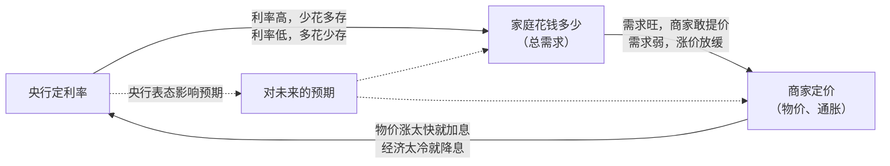

> **阅读说明**：本文事实以瑞典皇家科学院的新闻稿、科普材料和科学背景报告为准。官方材料以外的内容标 **【背景知识】**；为方便理解举的生活例子和中国例子标 **【类比】**，不代表官方观点。引语是笔者翻译的。

## 3 分钟看懂

- **谁得奖**：Robert E. Hall（斯坦福大学）和 Michael Woodford（哥伦比亚大学），两人平分奖金。2026 年 10 月 12 日公布。
- **为什么得奖**：官方原话是 "for microeconomic foundations of macroeconomic stabilisation"，意思是：为"让整体经济少大起大落"的政策，打下了"从每个人、每家企业的决策出发"的地基。
- **背景**：1970 年代，政府按老办法刺激经济，失业没降下来，物价反而飞涨。老办法失灵了。
- **Hall 做了什么**：他证明了一件事：**人们花多少钱，主要看对未来的预期，而不只看这个月挣了多少。**
- **Woodford 做了什么**：他把"人们看未来花钱""商家不会天天改价""央行用利率调控"这三件事，写成了一套简洁的模型。
- **有什么用**：今天世界各国的央行和财政部门都在用这套模型。你看到的每一次加息、降息背后，几乎都有它参与计算。

## 先补点基础

> 【背景知识】本节是通用的经济学常识，用来帮助零基础读者，不是官方材料的内容。

- **宏观经济学**：研究一个国家的经济整体，比如经济增长、失业率、物价。相当于站在高空看整座城市。
- **微观经济学**：研究一个人、一个家庭、一家企业怎么做决定，比如买不买、卖多少钱。相当于走进每家每户。
- **通胀（通货膨胀）**：东西普遍变贵，同样的钱能买的东西变少了。
- **利率**：借钱的价格。利率高，房贷月供就高，存钱的利息也高。
- **央行**：管一国货币和利率的机构，比如美联储、中国人民银行。它的主要工具是调利率。
- **财政政策**：政府通过花钱（修路、发补贴）和收税来影响经济。
- **稳定政策**：上面两类工具合起来，目标是让经济"不过冷也不过热"。

## 获奖速览

- **获奖者**：Robert E. Hall，1943 年生，斯坦福大学教授；Michael Woodford，1955 年生，哥伦比亚大学教授。两人都在麻省理工学院（MIT）获得博士学位。
- **奖金**：1200 万瑞典克朗，两人平分。
- **一句话**：Hall 证明了"老百姓花钱看未来"。Woodford 把这一点和"商家不会天天改价"结合起来，搭出一套模型，帮政府判断什么时候该踩油门、什么时候该踩刹车。

评审委员会主席 John Hassler 说："获奖者的工作为如今世界各国央行和政府所使用的模型提供了稳固的理论基础。有了这些模型，我们能更好地应对经济冲击，比如能源危机，或家庭消费的突然变化。"

## 时代背景：旧模型为什么失灵

### 凯恩斯的"油门和刹车"

近一百年前，经济学家凯恩斯提出一个观点。

**总需求**（全社会想买的东西加在一起）不会自动等于经济能生产的量。

- 需求太少：东西卖不掉，企业裁员，失业增加。
- 需求太多：经济"过热"，物价上涨。

所以经济冷的时候，政府和央行要"踩油门"：降息、多花钱。经济热的时候要"踩刹车"：加息、少花钱。

### 旧模型靠"统计规律"

传统模型靠的是从历史数据里总结出来的规律。比如：

- **菲利普斯曲线**：一条经验规律，失业多的时候物价涨得慢，失业少的时候物价涨得快。
- **消费函数**：收入多一块钱，消费就按固定比例多一点。

有了这些"固定比例"，计算该刺激多少就很简单。

### 1970 年代：规律突然失效

1970 年代发生石油危机，**失业和物价同时上涨**，这种情况叫"**滞胀**"（停滞加通胀）。

收入和消费的关系也变得不可靠。政府刺激多了，时机也不对，结果西方经历了十年的低增长、高失业和高通胀。许多人甚至主张干脆放弃稳定政策。

### 卢卡斯批判：地基有问题

1995 年诺奖得主卢卡斯指出了问题所在。

统计规律之所以失灵，是因为**人会对政策作出反应**。政策一变，人们的行为就变，过去的规律也就跟着变了。这个观点叫"**卢卡斯批判**"。

> 【类比】就像一家餐厅发现"打折那天客人多"，于是天天打折。顾客习惯以后，就只等打折才来。原来"打折就能多来客"的规律失效了。

所以模型必须有**微观基础**：从每个家庭、每家企业怎么做决定出发，再把结果加总成整个经济。

不过官方也承认，这"说起来容易，做起来难"。随后出现的"真实经济周期"（RBC）模型虽然有微观基础，却假设市场永远运转完美，那政府调控就没有意义了。

Hall 和 Woodford 的工作，是在微观基础上**重新证明"市场会出问题，政策可以帮忙"**。

> 【背景知识】卢卡斯批判通常追溯到 1976 年的论文，它和"理性预期革命"一起，标志着 1970—80 年代宏观经济学的大转向。

## Hall 的贡献：花钱看的是未来

### 难题：预期看不见

当时理论上已经认为，人们花多少钱，很大程度上取决于对**未来收入的预期**，而不只是现在的收入。

> 【类比】
> - 小王这个月拿了一笔**一次性**年终奖。他知道明年不一定有，所以多半存起来。
> - 小李**升职加薪**了，以后每个月都多拿钱。他就可能换车、换大房子。
>
> 两人这个月都多拿了钱，花法却完全不同。差别在于他们对未来的判断。

问题是，**预期藏在人的脑子里，看不见**。研究者一直找不到一个能代表"预期"的指标。

### 突破：把问题倒过来

Hall 想到：既然花钱由预期决定，那**花钱本身就是预期的"读数"**。乐观的人多花，悲观的人少花。

推下去：人只有听到**新消息**（升职、裁员传闻）才会改变花钱的计划。而新消息按定义是没法提前预测的。

所以结论是：**如果理论正确，一个人消费的变化也应该无法预测。**

于是 Hall 不再去找"能预测消费的指标"，而是去检验"消费变化到底能不能被预测"。

### 证据和"尤里卡时刻"

1978 年，Hall 用美国的数据检验：知道了当前的消费水平之后，过去的收入几乎无法帮助预测下一期消费怎么变。

官方称这是一个"**尤里卡时刻**"（恍然大悟的时刻），连怀疑他的同行都被说服了。

这还给出了一个**参照标准**：如果某些人的消费变化**能**被预测，就说明他们偏离了理论，比如手上没钱、也借不到钱。

### 80% 与 20%

1982 年，Hall 和 Mishkin 用 2309 个美国家庭（1969—1975 年）的数据估算发现：

- 约 **80%** 的家庭按"看未来"的方式花钱；
- 约 **20%** 的家庭"手停口停"，挣多少花多少，经济学上叫 **hand-to-mouth**。

官方指出，这个比例因时期、因国家而不同，但可以估算出来。今天的政策模型里同时有这两类家庭。

> 【类比】发消费券时，手头紧的家庭拿到券往往马上用掉，有积蓄的家庭可能顺手把本来要花的钱存起来。Hall 的方法能**算出两类人各占多少**，从而判断补贴发给谁效果最好。

## Woodford 的贡献：给政策搭一个"实验室"

### 一本书，一套模型

Woodford 在一系列论文的基础上（很多与 Julio Rotemberg 合作），于 2003 年出版了《利率与价格》（*Interest and Prices*）。书中提出了完整的**新凯恩斯模型**。

官方称它是此后所有同类模型的原型，相当于决策者的"**实验室**"。在里面可以先试一试：降息以后经济和物价会怎么变？要加息多少才能把物价稳住？

官方也强调，这套模型还建立在 Taylor、Calvo 等许多学者的成果之上。Woodford 是"总设计师"，完成了最后的组装。

### 三个关键角色

模型其实就是三条"规则"，分别描述三个角色：

1. **家庭怎么花钱**：来自 Hall 的理论。人们看未来花钱；利率越高，越愿意存钱、越少花钱。
2. **商家怎么定价**：商家不会天天改价，一旦调价就会预判未来的成本。物价因此取决于"大家觉得以后会涨多少"和"现在需求有多旺"。
3. **央行怎么定利率**：物价涨得快、经济太热，就加息；反之就降息。这条规则常被称为"**泰勒规则**"。按照规则，物价涨幅多 1 个百分点，利率要提得比 1 个百分点更多，才压得住。

三者互相影响，形成一个循环：

### 四个关键概念，用生活例子讲

**1. 用利率，而不是印多少钱，来调控**

受瑞典经济学家维克塞尔"**自然利率**"（既不刺激也不抑制经济的"中性"利率）概念的启发，Woodford 说明：央行直接调利率就能调控经济，模型里甚至不需要"市面上有多少钱"这个变量。如今绝大多数央行都是这样做的。

> 【类比】降息后，房贷月供变少，存款利息也变少。人们更愿意买房、买车，不太愿意把钱存银行。需求就被"拉"起来了。

**2. 价格粘性：商家不会天天改价**

**价格粘性**的意思是：价格调整得慢，不会随时变。因为改价有成本。

> 【类比】奶茶店原料涨价了，老板也不会第二天就换菜单。重印价目表、怕吓跑熟客，都是成本。于是价格会"粘"一阵子。

正因为价格调得慢，需求一下降，东西就卖不掉，企业只好减产、裁员。这就是需求会影响就业的根本原因。

商家一旦决定调价，就会**向前看**。如果预计原料和同行的价格以后还会涨，今天就一次多涨一点。

**3. 产出缺口：经济是"太热"还是"太冷"**

**产出缺口** = 经济实际生产的量 −"假如价格可以随时自由调整，经济本该生产的量"（叫**自然产出**）。

- 缺口为正：需求太旺，经济偏热，物价容易涨。
- 缺口为负：需求不足，经济偏冷，物价涨得慢。

稳定政策的任务，就是**把缺口推向零**。

> 【类比】像一家工厂：订单远超正常产能、天天加班，是"偏热"；订单不够、机器闲着，是"偏冷"。

**4. 可信与透明，以及"前瞻性指引"**

大家都看未来，所以人们**对未来利率的预期**今天就会影响物价和消费。官方指出，这是旧模型没有的洞见。因此央行说话要**清楚、可信**。

**前瞻性指引**就是央行提前公开告诉大家"未来一段时间利率会怎么走"。

> 【类比】如果央行可信地宣布"未来两年都维持低利率"，想买房的人知道房贷会长期便宜，今天就敢下决心买。利率还没变，表态已经起了作用。

### 一个反直觉的结论：油价暴涨时可能要加息

能源价格暴涨，经济能生产的量（自然产出）就下降了。如果商家没有及时把成本涨价转嫁出去，需求就**相对**显得太旺。即使实际产量也在下降，缺口仍可能为正。

这时模型建议**加息降温**，而不是刺激。官方认为，这让各国应对近年供给冲击的效果好于 1970 年代。

## 政策影响：从央行到财政部

1. **全球通用**：官方称，这类模型被世界各地的央行和财政部门使用，"根本没有其他可行的替代方案"。各国还会做本国版本，比如瑞典央行的 MAJA 模型。
2. **利率降到零时还有招**：美国在 2008—2015 年利率已接近零、没法再降。央行就用前瞻性指引，承诺长期保持低利率来刺激需求。这一做法由 Woodford 等人提出。
3. **财政和货币要一起看**：政府发补贴会推高物价，以控通胀为任务的独立央行可能随之加息，部分抵消补贴的效果。这套模型因此也成了分析财政政策的核心工具。
4. **危机应对**：官方认为，它在 2008 年金融危机、新冠疫情和近年的能源危机中都很有帮助，近年的通胀没有演变成 1970 年代那样的滞胀。不过官方也承认，这很难"排除合理怀疑"地证明，只能说学界有共识。

> 【类比 / 背景知识】
> - 中国人民银行近年更强调以政策利率（如 7 天期逆回购利率）为主要调控工具，与"用利率调控"的思路方向一致。
> - 国内常说的"稳预期""预期管理"，在理念上和 Woodford 强调的可信、透明相通。
> - "补贴向低收入群体倾斜"，可以用"手停口停家庭"的概念来理解。
>
> 注意：模型的一些假设（独立央行、价格由市场决定、利率能顺畅传导）在不同国家适用程度不同，不能生搬硬套。

## 争议与局限

官方科学背景报告自己就列出了这些挑战：

- **简化过头**：核心模型用了"直线近似"的数学处理，可能漏掉"利率最低只能到零附近"这类转折情况。
- **黑天鹅**：模型假设人们的预期是理性的，很难刻画战争、疫情这类突发事件对人心的影响。"大家相信通胀会回到目标"这一点，也不能视为理所当然。
- **价格粘性的设定比较随意**：常用的定价设定是"为了方便而设"的，在成本或需求剧变时尤其可疑。替代方案还没有形成共识。
- **前瞻性指引之谜**：在简单模型里，央行对遥远未来的承诺，对今天的影响大得不合理（Del Negro 等人，2023）。
- **只治病不防病**：模型针对的是已经发生的冲击。像 2008 年金融危机的成因，更多要靠金融监管来防范。
- **把所有家庭当成一个人**：基础模型用一个"代表性家庭"代表所有人。近年兴起的 HANK 模型（考虑家庭贫富差异的新凯恩斯模型）正在补上这一块，它直接承接了 Hall 和 Mishkin 的思路。

> 【背景知识】官方材料以外，常见的批评还有：2008 年危机前的主流模型对银行和金融市场刻画不足；行为经济学质疑"人们的预期是理性的"这一假设。这些批评推动了模型的后续改进。

官方的总体看法是：这套理论是一个研究方向的起点，不是终点。经济衰退和高通胀并没有消失，只是**持续时间变短了**。

## 名词小词典

| 名词 | 一句话解释 |
|---|---|
| 宏观经济学 | 研究一个国家整体经济（增长、失业、物价）的学问 |
| 微观经济学 | 研究个人、家庭、企业怎么做决定的学问 |
| 微观基础 | 从个体决策出发，推导出整体经济的规律 |
| 稳定政策 | 政府和央行"削峰填谷"，让经济少大起大落的政策 |
| 总需求 | 全社会想买的商品和服务加在一起 |
| 通胀 | 东西普遍变贵，钱变"不值钱" |
| 滞胀 | 经济停滞、失业多，同时物价还在涨 |
| 利率 | 借钱的价格 |
| 菲利普斯曲线 | 经验规律：失业多时物价涨得慢，反之涨得快 |
| 卢卡斯批判 | 人会对政策作出反应，所以历史统计规律会随政策变化而失效 |
| 预期 | 人们对未来（收入、物价、利率）的判断 |
| 手停口停（hand-to-mouth） | 挣多少花多少、没有积蓄也借不到钱的家庭 |
| 新凯恩斯模型 | 由家庭、商家、央行三条规则组成，用来分析稳定政策的模型 |
| 价格粘性 | 价格调整得慢，不会随时变化 |
| 自然产出 | 假如价格可以随时自由调整，经济本该生产的量 |
| 产出缺口 | 实际产出减去自然产出，衡量经济偏热还是偏冷 |
| 自然利率 | 既不刺激也不抑制经济的"中性"利率 |
| 泰勒规则 | 央行根据通胀和经济冷热来定利率的规则 |
| 前瞻性指引 | 央行提前公开告诉大家未来的利率走向 |
| 供给冲击 | 突然影响经济生产能力的事件，比如能源暴涨、供应链中断 |

## 读完你应该记住的 3 件事

1. **人们花钱看的是未来。** Hall 证明了这一点，所以政策要影响经济，关键是影响人们对未来的判断。
2. **商家不会天天改价，所以央行调利率有用。** Woodford 把这一点和 Hall 的发现组合成新凯恩斯模型，现在全球央行都在用。
3. **央行说话本身就是政策工具，但模型不是万能的。** 可信的表态能稳住预期；不过模型在黑天鹅事件、金融危机等问题上仍有明显局限。

## 延伸阅读

- 新闻稿：<https://www.nobelprize.org/prizes/economic-sciences/2026/press-release/>
- 科普材料：<https://www.nobelprize.org/prizes/economic-sciences/2026/popular-information/>
- 瑞典皇家科学院科普页：<https://www.kva.se/en/prizes/prize-in-economic-sciences/microfoundations-deliver-macro-insights/>
- 科学背景报告（英文 PDF，57 页，有公式）：<https://www.nobelprize.org/prizes/economic-sciences/2026/advanced-information/>
- 官方提到的核心文献：Hall (1978)；Hall & Mishkin (1982)；Woodford (2003) *Interest and Prices: Foundations of a Theory of Monetary Policy*
